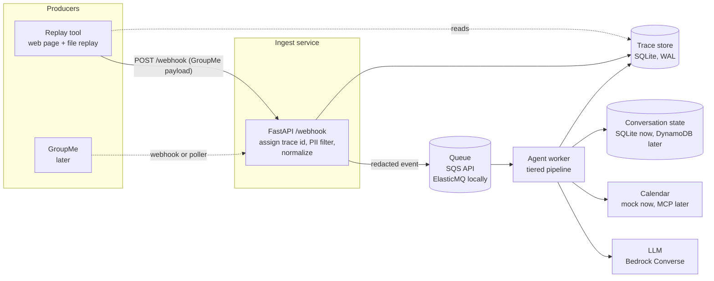

# Local MVP: ingest, queue, agent, replay and trace

This document describes how the chatbot runs on a developer machine (Python and Docker) and how messages are replayed for testing. It refines the "Components" section of [Scoping.md](../ideation/Scoping.md) for a local-first build. Where the two disagree, this document wins for the MVP, and the differences are listed under [Differences from Scoping.md](#differences-from-scopingmd).

## Goals

- Get an end-to-end loop running locally as fast as possible: message in, interpretation, calendar action, confirmation.
- Test without GroupMe or a public tunnel by replaying old messages as if they arrived on their original date, from their original sender.
- See everything that happened to one message (what came in, what the model was asked, what it answered, confidence, judge verdict, action).
- Keep the 911 PII rule intact: no raw message text is persisted, logged, queued or sent to a model.

## Non-goals (MVP)

- Real GroupMe ingestion (webhook from GroupMe, or the polling Lambda in Scoping.md), and the tunnel it would need.
- Terraform, Lambda, DynamoDB, the budget kill switch's AWS pieces.
- The self-healing and reviewer agents.
- The real calendar MCP server. A mock calendar stands in.

Each non-goal is reachable later without redesign, because it sits behind an interface described below.

## Architecture



Four containers in `docker compose`: `ingest`, `agent`, `queue` and `replay`. The trace store is a SQLite file on a shared named volume, used by all three Python services through one small library.

### Ingest service (webhook target)

A FastAPI app. For each POST to `/webhook` it:

1. Validates the body against the GroupMe callback shape (`id`, `created_at`, `group_id`, `sender_id`, `name`, `text`, `attachments`, `sender_type`, `system`).
2. Assigns a `trace_id` (the GroupMe message `id`; replay generates a fresh one per send).
3. Runs the **local PII filter** on the text (see [PII boundary](#pii-boundary)).
4. Builds the internal event, with redacted text only, and puts it on the queue.
5. Writes `inbound` and `pii_filter` trace steps, then returns 200 quickly.

Messages dropped by the filter (call details with no scheduling signal) or flagged as uncertain are never enqueued. The trace records the outcome and the reason, with no text.

The live and replay paths are the same route. A `source` field (`live` or `replay`) rides along in the event so replay events can be routed to the sandbox calendar and excluded from production metrics.

### Queue

The SQS API through `boto3`. Locally this is **ElasticMQ** (a small SQS-compatible container). In AWS it is real SQS, with no code change. Settings: a visibility timeout longer than the worst-case processing time, a dead-letter queue after N receives, and long polling in the worker.

The queue holds redacted events only, so a stuck message or the DLQ never contains raw chat text.

### Agent worker

Long-polls the queue and runs the tiered pipeline from Scoping.md, one trace step per stage:

| Step name | What it does | Model call |
|---|---|---|
| `roster` | sender to member and squad, permissions | no |
| `reply_match` | does this answer an open clarification? | no |
| `prefilter` | keyword and noise pre-filter | no |
| `date_parse` | rule-based date resolution against `sent_at` | no |
| `tier1` | classify (schedule or noise), extract JSON | cheap model |
| `tier2` | only on low confidence or judge rejection | stronger model |
| `schedule_lookup` | read the calendar for the dates involved | no |
| `judge` | check the proposed action, output confidence | model |
| `action` | apply through calendar, or ask a clarifying question | no |
| `reply` | the confirmation or clarification text to post | no |

The worker deletes a queue message only after the trace shows a terminal state (`done`, `clarify`, `ignored`, or `error`). Errors retry, then go to the DLQ.

Interfaces, each with a real and a fake implementation:

- `LlmClient.complete(prompt, model) -> response` with a Bedrock Converse implementation and a canned-response stub for tests.
- `Calendar.get(date_range)`, `Calendar.apply(change)` with a mock (in-memory, shown on the replay page) and later an MCP-backed client.
- `ConversationStore` with SQLite and a TTL column now, DynamoDB later.
- `Clock`: the pipeline never calls `datetime.now()`. See [Time](#time).

### Replay tool

A page served by the `replay` service. It talks to ingest over HTTP and reads the trace store directly. It writes nothing to the trace store.

- **Chat mode:** pick the sender (from the roster), a date and time (default: now), and the message text, then send. It builds a GroupMe-shaped payload with that `sender_id`, `created_at` and a fresh `id`, and POSTs it to `/webhook`.
- **File mode:** load a history file (the GroupMe export in `data/`, or `test_cases/labeled_examples.csv`) and replay it all at once, or one message at a time with a Next button. Original timestamps and senders are preserved. Replay can also start a labeled example from its `context` messages first.
- **Trace view:** click a message to see its full trace.
- **Calendar panel:** the mock calendar's current state, and a reset button.

Raw text exists in the replay page's browser memory, and in transit to ingest on localhost. It is not written to disk, the trace store, or logs by the replay service.

### Trace store

One SQLite database, one small Python library (`tracing`), several writers and one reader:

| Component | Writes | Reads |
|---|---|---|
| ingest | `inbound`, `pii_filter`, `enqueue` | no |
| agent | every pipeline stage | no |
| replay UI | nothing | yes |

Schema:

```sql
traces(trace_id TEXT PRIMARY KEY, source TEXT, sender_id TEXT, sent_at TEXT,
       status TEXT, created_at TEXT)
steps(trace_id TEXT, seq INTEGER, name TEXT, started_at TEXT, duration_ms INTEGER,
      input_json TEXT, output_json TEXT, error TEXT,
      PRIMARY KEY (trace_id, seq))
```

API shape (mirrors OpenTelemetry spans so Phoenix or another tool can be fed later):

```python
with trace.step(trace_id, "tier1") as s:
    s.input = {"prompt": prompt, "model": model}
    result = llm.complete(prompt, model)
    s.output = {"extraction": result.json, "confidence": result.confidence,
                "tokens_in": ..., "tokens_out": ..., "cost_usd": ...}
```

Concurrency: WAL mode, a busy timeout, short transactions, and one writer per trace at a time (a trace is only ever written by ingest and then by one worker). The DB sits on a **named Docker volume**, not a Mac bind mount, because WAL needs shared memory between processes. If lock contention or the volume turns out to be a problem, the fallback is a `/trace` write endpoint on ingest so only one process opens the file.

What a step may contain is limited by the PII policy below. The library enforces it (see next section).

## PII boundary

This follows Scoping.md: no 911 call PII reaches a model, and none is persisted or logged. The raw text exists only in memory while being processed.

Consequences for this design:

- **The PII filter runs in ingest, before the queue.** The queue, DLQ, trace store and logs only ever hold redacted text. This keeps the "raw only in memory" rule true without relying on every downstream component to behave.
- **`inbound` records metadata, not text.** Sender, timestamp, message length, and the redacted text. The trace's first text is the redacted version.
- **Dropped or flagged messages** are recorded as an outcome and a reason code (for example `incident_vocabulary_no_schedule_signal`), never with the text.
- **Fail closed.** If the filter errors or is unsure, nothing is enqueued and the trace says so.
- **Trace library guard.** `tracing` accepts text only through a `RedactedText` type, which only the PII filter can construct. A test asserts that no trace step is written with a plain `str` of message content.
- **Replay data.** The raw history export stays in the git-ignored `data/` directory. Replay reads it from disk and sends it to ingest, which redacts it. Labeled examples in `test_cases/` are already scrubbed.
- **Fixtures and CI.** The seeded synthetic PII test set from Scoping.md runs against the full ingest path, and fails the build if any known PII string appears in the queue payload, trace store, or logs.

Open question to settle when the filter is built: GroupMe member names in `name` are allowlisted roster names, but the filter must still treat them as untrusted input.

## Time

`created_at` from the payload is the message's time. It becomes `sent_at` (timezone-aware, converted to the squads' timezone, America/New_York) and is the only "now" the pipeline knows.

- Prompts include `sent_at`, so "tonight" and "tomorrow" resolve relative to when the message was sent.
- Relative dates are resolved in code (`date_parse`) where possible, and the LLM returns a reference (for example `{"date_ref": "tonight"}`) that code turns into a date. That is deterministic and testable.
- A `Clock` object holds the notion of "now" for the pipeline. Live mode uses the message time too, so live and replay take the same path.

## Differences from Scoping.md

| Topic | Scoping.md | MVP |
|---|---|---|
| Ingestion | EventBridge poller Lambda against the GroupMe API | HTTP webhook, fed by the replay tool |
| Queue | not specified | SQS API (ElasticMQ locally) |
| Conversation state | DynamoDB with TTL | SQLite with a TTL column |
| PII filter location | start of the pipeline | in ingest, before the queue |
| Observability | decision records, CloudWatch | local SQLite trace store plus replay UI |
| Calendar | MCP server over the HTTP service | mock behind a `Calendar` interface |

## Moving to self-hosted and to AWS

Kept as a running list, as requested in Scoping.md.

| Component | Local MVP | AWS deployment |
|---|---|---|
| Ingest | FastAPI container | Lambda (Mangum) behind API Gateway, or the poller Lambda |
| Queue | ElasticMQ | SQS (same `boto3` calls, change endpoint and credentials) |
| Agent | container, long polling | Lambda with SQS trigger |
| LLM | Bedrock via real AWS credentials; stub in tests | Bedrock via IAM role |
| State | SQLite | DynamoDB with TTL |
| Trace store | SQLite on a named volume | DynamoDB or an S3/Athena log; see the open question below |
| Calendar | mock | MCP server over the existing HTTP service |
| Tunnel | none | not needed |

Open question: SQLite does not suit Lambda, so the AWS trace store needs a decision (likely DynamoDB keyed by `trace_id`, `seq`). The `tracing` library hides the backend, so this is a swap, not a rewrite.

## Open questions

1. Cross-squad edit guardrails (still TBD in Scoping.md).
2. Whether to feed traces to Arize Phoenix later. Out of scope for the MVP.
3. Redaction recall limits, and what the replay tool should show when a message was dropped.
4. Bedrock quotas and which region and models to use.
