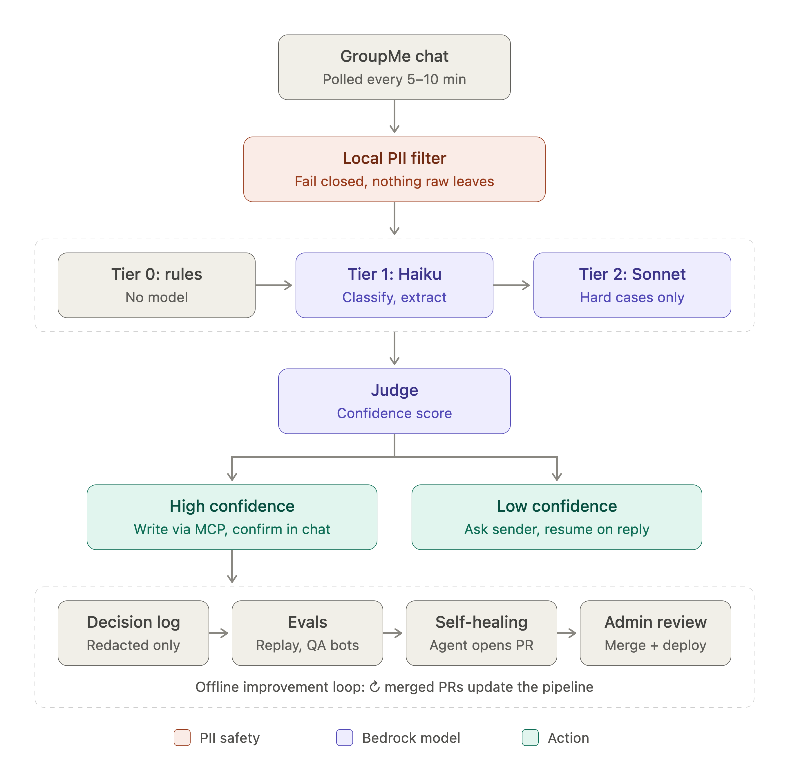

# Overview
I'm thinking about building an AI agent to help manage scheduling coordination for a group of 5 volunteer EMS (911 ambulance) squads that share coverage responsibilities across their territories. The squads coordinate over a shared GroupMe chat, where chiefs post updates like crew shortages, mixed in with unrelated chatter. My agent reads the chat, figures out which messages actually affect coverage, and updates our shared Google Sheets duty calendar automatically, asking a follow-up question if a message is unclear. A second agent watches how the first one performs and can tweak its own logic over time to get better at the job.

## Some implementation constraints / ideas
- I want to use AWS, specifically Bedrock for LLM. 
- I am flexible on the other components.  It might be nice to abstract it such that instead of posting a lambda we could deploy as a local Python service easily to something like Docker.  One idea is to keep a running document that details what should be modified if this were to be converted to a self hosted project on a local mac computer
- There will be a data store to cache active conversations.  Conversations have a rather short lifetime, so will probably have a TTL of 24 - 48 hours.  The data is not relational, so no requirement for Postgresql or other sql based DBMS.  Since we are using AWS, DynamoDB might be an option but if we cannot keep it in the free tier, then I would consider a classic dbms, or even Supabase which would be free.
- All AWS components will be configured via Terraform
- Volume is low, with long gaps inbetween.  We could go weeks without a message, then we could get series of messages, but it is never more than 4 or 5 individuals sending an infrequent message.  
- Message interpretatiion should be: 
  - Response to a previous conversation
  - Classify - scheduling message or noise?
  - extract dates from request
  - Call tools to check if squad was scheduled on the date determined
  - Determine request
  - Judge determination
  - call tools to implement schedule change requested
- I want to divide group message processing into phases: try to interpret programmatically, try to interpret using a cheap (maybe even local) model, then send to more expensive models if necessary

## Problem
Station 95 is a collaborative of 5 volunteer EMS squads that share 911 coverage across their territories. The source of truth for who is covering when is a shared Google Sheet laid out as a calendar (per-day time blocks, one column per scheduled squad). Changes to coverage (crew shortages, swaps, added shifts) are announced informally in a shared GroupMe chat, mixed in with unrelated chatter.

Keeping the calendar in sync with the chat is a manual job today:
- Someone has to notice the relevant messages among the noise.
- The messages are informal and often ambiguous: relative dates ("this Tuesday"), overnight shifts that cross midnight (1800–0600), and requests that span several messages or replies.
- Someone has to translate each request into the right calendar edit and follow up when it's unclear.

When this lags or goes wrong, the calendar no longer reflects real coverage, and gaps or double-coverage go unnoticed.

## Why it matters / impact
- **Public safety:** the duty calendar describes real 911 coverage. A stale or wrong calendar can hide an uncovered shift.
- **Volunteer time:** chiefs and schedulers are volunteers. Removing the manual read-and-transcribe step gives that time back.
- **Traceability:** every calendar change is tied to the message that caused it, the model's reasoning, and a public confirmation in the chat.
- **Professional (interview prep):** a realistic, production-used system that shows:
  - workflow vs. agent design decisions
  - tiered model routing for cost
  - LLM-as-judge confidence gating
  - human-in-the-loop clarification
  - evaluation with historical and synthetic data
  - a governed self-improvement loop
  - MCP tool integration
  - Terraform infrastructure
  - cost guardrails

## Proposed Approach

### Design principle: workflow first, agents where they earn it
The core message pipeline is a **deterministic workflow** with LLM calls at fixed steps. That makes it predictable, testable and cheap, which suits a production duty schedule. True **agents** (an LLM in a tool-use loop choosing its own steps) are used only for the open-ended jobs: self-healing, PR review, and synthetic users.

### Design principle: no 911 call PII ever reaches a model
Squad chat can mention details of real 911 calls: patient names, addresses, ages, medical conditions, incident numbers and call narratives. **None of this may ever be sent to an LLM** (Bedrock or any other). It also must not be persisted, logged, or used in eval datasets or the self-healing loop.

- **Local PII filter.** Every message passes through a deterministic filter, running locally, before any model call. The filter combines:
  - **Pattern rules:** phone numbers, street addresses, dates of birth, ages, incident/call numbers.
  - **Local NER** (e.g. Microsoft Presidio with spaCy; no external calls) to detect person names and locations.
  - **A medical/incident vocabulary list:** chief complaints, conditions, dispositions such as "transported to…".
- **Allowlist of known entities.** Member names, squad numbers, territory names and shift times are known. They are allowed through so scheduling still works. Any other name or location is redacted.
- **Fail closed.**
  - If a message looks like call details (incident vocabulary) and has no scheduling signal, it is dropped entirely. It is not sent even in redacted form.
  - If the filter errors or is unsure, the message is not sent to a model. It is flagged for the admin instead.
- **Minimize what is sent.** Models receive only the redacted text needed for the task, never raw messages.
- **Redacted-only everywhere downstream.** Conversation state, decision records, logs, eval sets (including the 2-year historical export, which is scrubbed before use) and anything the self-healing, reviewer or synthetic agents see contain only redacted text. Raw message text lives only in memory during processing.
- **Tested and documented.**
  - A seeded PII test set (synthetic call details) runs in CI. Any leak fails the build.
  - The PII policy is documented in the repo.
  - The self-healing agent may not weaken the filter. Changes to the filter require explicit admin review.

### Components
1. **Ingestion:**
   - An EventBridge Scheduler triggers a Lambda that polls GroupMe every 5–10 minutes and processes new messages as a batch.
   - Messages are de-duplicated by message ID, with a high-water mark stored in DynamoDB.
2. **Conversation state:**
   - DynamoDB (on-demand) holds active conversations and pending clarifications.
   - Items expire after 24–48 hours (TTL).
3. **Member roster (config):** members, the squads they belong to, and permissions.
   - Anyone may modify their own squad's schedule.
   - Edits to another squad's schedule are allowed, subject to guardrails (TBD).
4. **Interpretation pipeline (tiered):**
   - **Tier 0, deterministic (no model):**
     - Local PII filter (see the design principle above). It runs first, and no text reaches a model without passing it.
     - Sender/roster lookup.
     - Matching replies to an open conversation.
     - Keyword/noise pre-filter.
     - Rule-based date parsing.
   - **Tier 1, cheap Bedrock model (e.g. Haiku):**
     - Classify the message as scheduling or noise.
     - Extract structured JSON: squad, dates, time blocks, intent (add / remove / swap / short-crew).
   - **Tier 2, stronger Bedrock model (e.g. Sonnet):** only used when Tier 1 is low-confidence, the message is complex, or the judge rejects Tier 1's output.
   - **Tool calls:** query the current schedule for the dates involved to ground the request.
   - **Judge:** a separate LLM call checks the proposed calendar action against the original message and the current schedule, and outputs a confidence score.
5. **Action:**
   - **High confidence:**
     - Apply the change through the calendar **MCP server** (a wrapper over the existing HTTP service).
     - Post a confirmation in GroupMe (e.g. "Removed Squad 34 from 10/12 1800–0600").
   - **Low confidence:**
     - Post a clarification question in the chat to the original sender.
     - Save the pending state.
     - When they reply, resume the pipeline with that added context.
     - If nobody replies before the TTL, notify the admin.
6. **Observability and feedback:**
   - Every decision is stored as a structured record: redacted input, tier used, extraction, judge score, action, cost.
   - Admin manual corrections are captured as labeled data.
7. **Evaluation:**
   - **Historical replay:** about 2 years of GroupMe messages compared against what ended up on the calendar, used as a golden set. The export is run through the PII filter before it is stored or used.
   - **Synthetic users:** an agent posts realistic requests to a separate QA GroupMe channel.
   - Results are scored automatically, and a human reviews a sample.
8. **Self-healing loop:**
   1. An agent (e.g. Claude Agent SDK on Bedrock, run on a schedule or in GitHub Actions) reviews failures, low-confidence cases and admin corrections.
   2. It proposes prompt and/or code changes.
   3. It runs the eval suite and opens a PR with the results.
   4. A separate reviewer agent critiques the PR.
   5. The admin approves.
   6. CI/CD deploys the change.

   The agent never deploys its own changes.
9. **Infrastructure:**
   - All AWS resources are in Terraform: Lambda, EventBridge Scheduler, DynamoDB, SSM Parameter Store for secrets (free, unlike Secrets Manager), and CloudWatch.
   - The core logic is a plain Python package with a thin Lambda handler.
   - A running doc describes what to change to self-host each component on a local Mac (e.g. in Docker).
10. **Cost controls:**
    - AWS Budgets alerts at e.g. 50 / 80 / 100% of a monthly cap, sent via SNS to email.
    - **Kill switch:** when the budget is breached, an SNS-triggered Lambda disables the EventBridge schedule and sets Lambda reserved concurrency to 0. It is re-enabled manually.
    - **App-level guard:** AWS billing data can lag by hours, so a real-time token/cost counter in DynamoDB enforces daily and monthly caps and a maximum number of model calls per message.

### 3-week plan
- **Week 1:**
  - Terraform skeleton and the cost kill switch
  - Local PII filter and its CI test set (before any model call is wired up)
  - Ingestion and conversation state
  - Tier 0 and Tier 1 pipeline
  - Calendar MCP wrapper
  - Confirmations
  - Build the historical eval set
- **Week 2:**
  - Tier 2 escalation and the judge
  - The clarification loop
  - Roster guardrails
  - Synthetic-user agent and QA channel
  - Eval harness and observability
- **Week 3:**
  - Self-healing agent, reviewer agent and the PR/deploy flow
  - Hardening and docs
  - Demo
  - If time runs short, the self-healing loop is the first thing to scale back (for example, propose-only PRs with no automated eval run).

## Key success metrics
Targets are initial guesses, to be calibrated against the historical set.
- **PII sent to a model:** 0. This is a hard requirement, not a target. It is measured by the seeded PII test set in CI and by sampled audits of redacted production records.
- **Scheduling-message recall:** ≥ 95%. Missing a coverage change is worse than a false positive.
- **Action accuracy:** ≥ 90% of scheduling messages produce the correct calendar state, measured on historical and synthetic sets.
- **Wrong writes at high confidence:** ~0. This is the key safety metric.
- **Clarification rate:** < 20% of scheduling messages need a follow-up question.
- **Admin correction rate:** manual fixes per month, trending down over time.
- **Latency:** a message is reflected on the calendar within about 15 minutes (the poll window plus processing time).
- **Tier distribution:** the % of messages resolved at Tier 0, 1 and 2. Most should never reach Tier 2.
- **Cost:** monthly AWS spend under the budget cap, plus cost per processed message.
- **Self-healing effectiveness:** % of agent PRs merged, and the change in eval score after merge (no regressions).

## Key risks / unknowns
- **Wrong write to a production 911 schedule.**
  - *Mitigations:* judge gating, a confidence threshold, public confirmations, roster permission checks, and undo/audit through the calendar service.
- **Prompt injection via chat content.** Chat text is untrusted input. This is especially dangerous for the self-healing agent, which can change code.
  - *Mitigations:*
    - The self-healing agent sees sanitized or summarized cases.
    - It has no production credentials or secrets.
    - Its output is PR-only, gated by CI evals and human approval.
    - IAM permissions are least-privilege.
- **Sparse labeled data.** Historical replay may be noisy (the calendar may have been edited for reasons not in the chat). Synthetic data may not match how chiefs actually write.
- **Language ambiguity:**
  - relative dates
  - week boundaries
  - overnight shifts that cross midnight
  - multi-message or threaded requests
  - typos and squad nicknames
- **Clarifications that never get answered.** The behavior on timeout needs to be defined.
- **Cross-squad edit guardrails** are still TBD.
- **Cost overrun.** Billing data lags, so a short spike could be missed. This is mitigated by the app-level counter and the kill switch.
- **911 call PII reaching a model or being persisted.** Local NER and pattern rules will never have perfect recall: unusual names, misspellings, or narrative details with no obvious pattern can slip through.
  - *Mitigations:*
    - An allowlist of known entities, so any unknown name or location is redacted.
    - Fail-closed handling: call-detail messages are dropped, and uncertain cases go to the admin.
    - A CI leak test set.
    - Redacted-only storage and logs.
    - Changes to the filter require admin review.
    - A documented PII policy.
  - *Trade-off:* aggressive redaction may remove context the model needs. A higher clarification rate is acceptable in exchange.
- **GroupMe API:** rate limits, polling gaps, and how reply threading is represented.
- **Bedrock model access:** models must be enabled per region, and their availability and pricing can change.
- **Adoption and trust:** chiefs need to trust the bot, and its messages shouldn't add noise to the chat.
- **Timeline:** 3 weeks is tight for the self-healing loop. It is the most likely thing to be scaled back.
